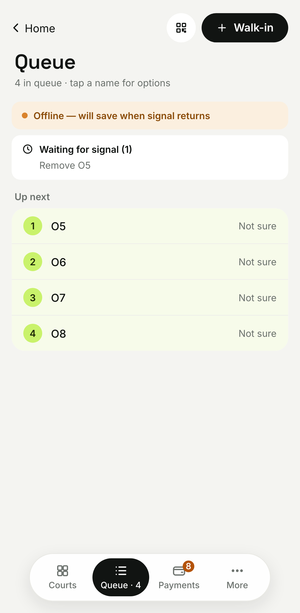
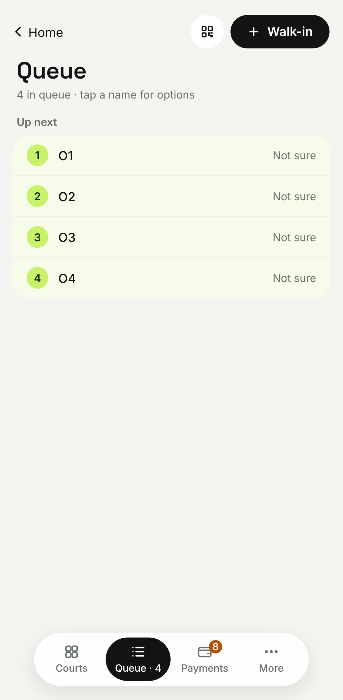
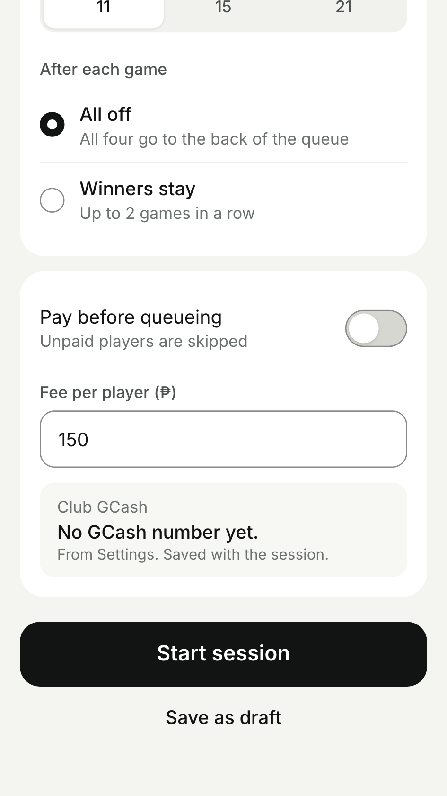
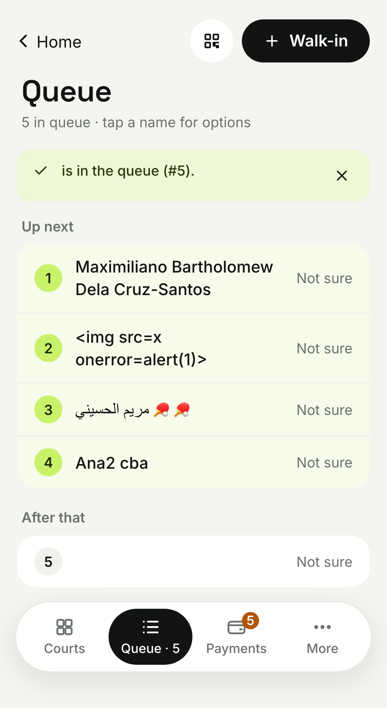

# QA audit before the pilot (November 2026)

Adversarial audit of **origin/main at f297c9a** (v5 UI, skeleton loading, pre-pilot rotation fix),
run against the **local stack only** (`npx supabase start` + a local production build on port 3100).
No cloud project, no `--remote` commands, no service-role key. App code, migrations and tests were
not changed; throwaway scripts live in `qa/scratch/` (git-ignored).

Tools: supabase-js with the anon key and real sign-ins for each role; SQL scenarios run as the
`authenticated` role with a test user's claims (like the pgTAP tests, rolled back after each run);
two concurrent `psql` sessions for races; Playwright (Pixel 7, plus 360×640) with separate browser
contexts per device.

Local data left behind: the race fixture was committed and then deleted; the API and Playwright runs
left test clubs in the local database (names starting with "QA", "qa-" or "Outbox Night"), as the e2e
suite does. Nothing touched the cloud project.

## 1. Summary

| Severity | Count |
| --- | --- |
| P0 | 0 |
| P1 | 3 |
| P2 | 2 |
| P3 | 8 |
| **Total** | **13** |

No data leak across clubs or roles was found: every read, write, RPC and Realtime subscription
against another club's data was refused (see Tested and OK).

**Top 5 to fix before the pilot**

1. **QA-01** Switching a session tab without signal drops the organizer onto the browser's offline
   page, and it stays there after the signal returns.
2. **QA-02** The offline outbox silently drops a queued Remove/Pause/Resume when that player was
   called in the meantime; the organizer is never told.
3. **QA-03** Winners stay with fewer than 2 waiting: the winning pair is called again every game and
   the 2-in-a-row limit (BR11) never applies.
4. **QA-04** On New session, the BR1 refusal ("Another session is live") and field errors appear
   above the screen; nothing visible happens when the organizer taps Start.
5. **QA-05** Unlimited anonymous check-ins: one person can add many queue entries (same or
   different names) from one phone.

## 2. Findings

| ID | Severity | Area | Title | Status |
| --- | --- | --- | --- | --- |
| QA-01 | P1 | Offline | Tab switch offline lands on the browser's offline page | Confirmed |
| QA-02 | P1 | Offline / queue | Outbox drops a queued Remove/Pause/Resume silently when the player was called meanwhile | Confirmed |
| QA-03 | P1 | Queue (BR11) | Winners stay with fewer than 2 waiting: winners play every game | Confirmed |
| QA-04 | P2 | UX | New session errors (BR1 refusal, field errors) shown off-screen | Confirmed |
| QA-05 | P2 | Abuse | Unlimited anonymous check-ins per session from one device | Confirmed (local limits) |
| QA-06 | P3 | Access | 6-character codes can be guessed without throttling; a live code shows the club's GCash number | Suspected |
| QA-07 | P3 | Input | Invisible (zero-width) names and right-to-left override characters are accepted | Confirmed |
| QA-08 | P3 | Access | Redirect and link host taken from `X-Forwarded-Host` | Suspected (deployment) |
| QA-09 | P3 | Queue (BR19) | `swap_not_ready` swaps players who never said "not ready" | Confirmed (API only) |
| QA-10 | P3 | Validation | Server accepts a walk-in with no payment choice (D18) and fees above ₱100,000 | Confirmed (organizer/API only) |
| QA-11 | P3 | Accessibility | "+ Walk-in", "Done", "Call next", "Need N more" pills have no 44×44 touch area | Confirmed |
| QA-12 | P3 | Queue | Switching rotation off and back on mid-game lets a pair play a 3rd game in a row | Confirmed |
| QA-13 | P3 | Copy | "All off: All four go to the back of the queue" also shown for singles | Confirmed |

## 3. Findings in detail

### QA-01 (P1): Tab switch without signal lands on the browser's offline page

**Steps (clean state)**
1. Sign in as an organizer, start a 1-court session, add 5 walk-ins, call Court 1.
2. Open the Queue tab, then the Courts tab (both visited online).
3. Turn the signal off (Playwright: `context.setOffline(true)`). The "Offline — will save when signal returns" notice shows.
4. Tap **Queue** in the session tab bar.
5. Turn the signal back on and wait.

**Expected.** NF10: the organizer keeps working without signal; taps are saved and sent later. At
least the app stays on screen (or explains that the tab needs signal).

**Actual.** The page navigates to `chrome-error://chromewebdata/` (Chrome's "No internet" page;
blank in the headless capture). After the signal returns it **stays there**; the organizer must
reload by hand. Same result in both runs. The outbox itself survives (it is in localStorage), but
the organizer is out of the app at the worst moment.

**Evidence.** `qa/scratch/offline-tabs.qa.ts`, both runs:
```
{"after":{"url":"chrome-error://chromewebdata/","hasTabBar":0},"afterReconnect":{"url":"chrome-error://chromewebdata/","hasTabBar":0}}
```


**Likely cause.** The tab bar uses `next/link` to dynamic routes
(`src/components/nav/TabBar.tsx:46`). Offline, the App Router's RSC fetch fails and Next falls back to
a full-page navigation, which the browser can't load. There is no service-worker fallback. The
same probably applies to the other in-session links (Show QR, Walk-in, Home); only the tab bar was
tested.

**Fix direction.** When `navigator.onLine` is false, don't navigate: keep the current tab and show
"Needs signal" (or serve cached tab pages); consider a service-worker offline fallback page.

**Product decision?** No.

### QA-02 (P1): Outbox drops a queued Remove silently when the player was called meanwhile

**Steps (clean state)**
1. Organizer starts a 1-court session, adds walk-ins O1–O8, calls Court 1 (O1–O4 play). Open the Queue tab.
2. Phone 2 (same organizer account) opens Courts, online.
3. Phone 1 loses signal, taps O5 → Remove from queue → Yes, remove. "Waiting for signal (1): Remove O5" shows.
4. Phone 2 taps **Done on Court 1**: O5–O8 are called.
5. Phone 1 gets signal back.

**Expected.** NF10: queued actions are applied once, in order; if one can't be applied the organizer
is told ("Not sent: …", with Discard), as the outbox does for other errors.

**Actual.** On reconnect the queued "Remove O5" disappears with **no message**, and O5 is **playing**
on Court 1 (no `player_removed` event). Phone 1's organizer believes O5 was removed. Same in both runs.

**Evidence.** Database after each run:
```
Outbox Night 2 | O5 | playing | O5,O6,O7,O8 | removed events: 0
Outbox Night 1 | O5 | playing | O5,O6,O7,O8 | removed events: 0
```
Before reconnect:



After reconnect (no message; O5 is now on court):



**Likely cause.** `src/lib/outbox/rules.ts:35-37` treats `invalid_player_status` as "already done"
for `pause_player`, `resume_player` and `remove_player`, and `replayOutbox` counts that as success
(`rules.ts:86`). But the database raises the same `invalid_player_status` when the player is on court
(`pause_player`/`resume_player`: `supabase/migrations/20261124084323_phase3_queue.sql:531/550`; `remove_player`: `supabase/migrations/20261124140512_phase5b_fewer_steps.sql:325`), so "already removed" and "can't
remove, they're playing" look the same. The same happens with one phone if Done and Remove are both
queued offline and the Done calls that player.

**Fix direction.** Only count it as done when the player is already in the target state (e.g. return a
distinct code such as `player_playing`, or re-read the row); otherwise show "Not sent: Remove O5 —
O5 is on court" so the organizer can decide.

**Product decision?** No.

### QA-03 (P1): Winners stay with fewer than 2 waiting: winners play every game

**Steps (clean state)**
1. Start a 1-court doubles session in **Winners stay** with 5 players (P01–P05); call Court 1 (P01–P04).
2. Done, winners P01+P02 (1 player waiting). Repeat twice more with the same winners.

**Expected.** BR11: winners stay for **at most 2 games in a row**; then everyone goes off.

**Actual.** Each time, all four go off (winners first) and the next call takes P01 and P02 straight
back, with `winner_streak` reset to 0, so the limit never triggers. P01+P02 played 4 games in a row
while P03–P05 each sat out. Deterministic in both runs:
```
[1] win P01+P02 (1 waiting)  -> court 1 [streak 0]: #2 P05,P01,P02,P03
[2] win P01+P02 again        -> court 1 [streak 0]: #3 P04,P01,P02,P05
[3] win P01+P02 a third time -> court 1 [streak 0]: #4 P03,P01,P02,P04
```
(`qa/scratch/s03-winners.sql`.) Singles with 3 players gives the same result by the other path: P01
wins twice, hits the limit, all go off "winners first", and the next call takes P01 straight back.
P01 played all 4 games (`qa/scratch/s09-winners-singles.sql`).

**Likely cause.** The written rule itself: "Second win in a row, or fewer than 2 waiting: all four go
off (winners first)" (`supabase/migrations/20261124084323_phase3_queue.sql:481`), implemented at
`supabase/migrations/20261124140512_phase5b_fewer_steps.sql:263-266` (`requeue(v_winners || v_losers)`
and the streak reset to 0). With few players waiting, "winners first" puts the winners first in line
for the immediate re-call, so they never sit. The e2e suite (`e2e/queue.spec.ts`, winners stay) expects
the winners in the next call, so this is the rule producing an unfair result, not a coding slip.

**Fix direction.** In the fallback, re-queue losers before winners (or keep counting the streak), so
the 2-game limit holds when few players wait.

**Product decision?** Yes: whether "go off" should put losers ahead of winners, and who sits out when
only 1 player is waiting.

### QA-04 (P2): New session errors shown off-screen

**Steps (clean state)**
1. Organizer with a live session opens **New session** on a 360×640 screen (also Pixel 7).
2. Type a name, scroll down, tap **Start session**.
3. Separately: leave the name empty, set Ends before Starts, tap **Save as draft**.

**Expected.** Each error is visible where the user is looking (the audit brief's known bug class);
the organizer understands why nothing happened.

**Actual.** The "Another session is live…" alert renders at the top of the form, **684 px above the
viewport** on 360×640 (398 px above on Pixel 7); the Start button stays in view and nothing else
changes. Field errors behave the same: "Enter a session name." is 572 px above the viewport, and the
"Some fields need fixing" notice is not in view either. Both runs gave the same positions.
```
br1-error-position (360x640): {"alert":{"top":-684,"bottom":-627,"visible":false},"button":{"top":500,"visible":true}}
br1-error-position (Pixel 7): {"alert":{"top":-398,"bottom":-341,"visible":false}}
new-session-field-errors:     {"nameError":{"top":-572,"visible":false},"formNotice":{"top":-723,"visible":false}}
```



**Likely cause.** `src/app/sessions/new/NewSessionForm.tsx:31` renders the form error at the top of
the form; nothing scrolls to or focuses the first error after the server action returns.

**Fix direction.** After a failed submit, scroll to and focus the first error (or show the BR1
refusal next to the Start button).

**Product decision?** No.

### QA-05 (P2): Unlimited anonymous check-ins per session from one device

**Steps (clean state)**
1. Start a live session.
2. From one machine, 40 times: fresh anonymous sign-in (as after clearing the browser), then
   `join_session` with the same code and the name "Same Name".

**Expected.** One fair line: one entry per person; a troll can't flood the queue.

**Actual.** All 40 joins succeeded; the queue had 40 rows, all "Same Name". Locally the anonymous
sign-in limit is 1,000 per hour per IP (`supabase/config.toml:211`); the cloud value wasn't checked.
Duplicate names are allowed (also a walk-in plus the same person's phone).
```
spam: 40 joins ok, 0 refused; queue rows now 40
```

**Likely cause.** `join_session` allows one row per anonymous user, but a new anonymous user is free
(`supabase/migrations/20261124111035_phase5_payments.sql:303`); there's no per-session cap or
duplicate-name check.

**Fix direction.** Lower the cloud anonymous sign-in rate limit, warn the organizer about duplicate
names, and/or add a "remove all joins from the last N minutes" or a per-session cap.

**Product decision?** Yes (how strict to be at the door).

### QA-06 (P3, Suspected): Codes guessable without throttling; a live code shows the GCash number

**Steps.** Signed out, call `checkin_preview` (and `club_entry`) with random 6-character codes, 20 at a time.

**Expected.** Codes are the only key to a session's check-in; guessing should be impractical.

**Actual.** About **750 guesses per second** locally with no throttling (2,000 in 2.7 s, 0 errors).
The keyspace is 31^6 ≈ 887 million, so one specific session is safe, but with many live sessions a
script finds *some* live session in hours. A hit returns the session name, fee and the club's GCash
name and number (`checkin_preview`), and allows joining (see QA-05). `club_entry` returns the club
name even when nothing is live. After a session ends, nothing leaks (status only).

**Likely cause.** Anonymous RPCs `checkin_preview` / `club_entry`
(`supabase/migrations/20261124111035_phase5_payments.sql:254`, `...phase5b_fewer_steps.sql:497`) with
6-character codes (`...phase2_sessions.sql:20`) and no rate limit in front of PostgREST.

**Fix direction.** Rate-limit these RPCs per IP (edge function or proxy), or make the QR carry a
longer token while keeping the 6-character code for typing.

**Product decision?** Yes (accept the risk for the pilot?). Not verified on the cloud project.

### QA-07 (P3): Invisible names and right-to-left override are accepted

**Steps.** Check in (or add a walk-in) named `​​​` (3 zero-width spaces), and one named
`Ana‮abc 2`.

**Expected.** A name the organizer can read and call.

**Actual.** Both are stored. The zero-width name shows as a **blank queue row** (#5) and the banner
reads " is in the queue (#5)."; the override name renders as "Ana2 cba" (reversed). The effect stays
inside the row (no spill into other rows). HTML/script names render as plain text (safe).



**Likely cause.** `session_players_before_write` only collapses whitespace
(`supabase/migrations/20261124084323_phase3_queue.sql:111`); the length check counts invisible characters.

**Fix direction.** Strip format characters (Unicode category Cf: zero-width, bidi controls) before the
length check.

**Product decision?** No.

### QA-08 (P3, Suspected): Redirect and link host taken from `X-Forwarded-Host`

**Steps.** `curl -H "X-Forwarded-Host: evil.example" "http://localhost:3100/auth/callback?code=bad"`.

**Expected.** Redirects stay on the app's own host.

**Actual.** `Location: http://evil.example/login?error=auth` (same for `/auth/confirm`). A browser
can't set this header, so it only matters if the production proxy passes a client value through
(or a cache stores the response). The `next` parameter itself is safe (see Tested and OK).

**Likely cause.** `src/lib/http/origin.ts:6` trusts `x-forwarded-host` unconditionally; used for auth
redirects, QR links and invite links.

**Fix direction.** Use a configured site URL (env) or an allowlist of hosts.

**Product decision?** No. Check the hosting platform's header behavior.

### QA-09 (P3): `swap_not_ready` swaps players who never said "not ready"

**Steps.** As an organizer, call `swap_not_ready(court, player)` for a playing player whose
`not_ready_at` is null, with players waiting.

**Expected.** BR19: the player flags "not ready", then the organizer swaps them out to the **front** of
the queue.

**Actual.** The swap succeeds; the swapped player goes to the front. The UI only offers Swap for
flagged players, so this needs an organizer calling the API.

**Likely cause.** `supabase/migrations/20261124102001_phase4_players.sql:373` doesn't check `not_ready_at`.

**Fix direction.** Refuse unless `not_ready_at` is set, or make "swap anyone out" an explicit feature.

**Product decision?** Yes: an organizer may want to replace an injured walk-in (no phone) mid-game;
today they can't pause or remove a playing player.

### QA-10 (P3): Server accepts a walk-in with no payment choice, and fees above ₱100,000

**Steps.** As an organizer through the API: `add_walk_in(..., p_payment => null)` on a ₱150 session;
`create_session(..., p_fee => 2147483647)`; `update clubs set default_fee = 9999999`.

**Expected.** D18: with a fee, a walk-in needs a payment choice. The app limits fees to ₱100,000.

**Actual.** All accepted. The walk-in becomes unpaid (a safe default under pay-first). Only the app's
forms enforce these rules; anyone calling the API as an organizer can bypass them.

**Likely cause.** `supabase/migrations/20261124170000_phase7_members.sql:138` (payment applied only
when given); fee bound only `>= 0` (`...phase2_sessions.sql:82`), `FEE_MAX` only in `src/lib/club/validation.ts:12`.

**Fix direction.** Mirror D18 and `FEE_MAX` in the database.

**Product decision?** No.

### QA-11 (P3): Compact pills have no 44×44 touch area

**Steps.** On 360×640, measure every interactive element on Courts and Queue (including the
`touch-target` ::after area).

**Expected.** CLAUDE.md: compact buttons 36–40 px tall with a 44×44 touch area.

**Actual.** Under 44 px tall: "+ Walk-in" (119×40), "Done on Court 1" (82×40), "Need 3 more"
(135×40); "Call next N" uses the same pill. Payments, New session and Settings had none.

**Likely cause.** `size="pill"` in `src/components/ui/Button.tsx:58` has no `touch-target`
(used in `src/app/s/[id]/_components/LiveHeader.tsx:13` and `CourtCard.tsx:116/152/156`).

**Fix direction.** Add `touch-target` to the pill size.

**Product decision?** No.

### QA-12 (P3): Rotation off-and-on mid-game gives a pair a 3rd game in a row

**Steps.** Winners stay, P01+P02 win (streak 1); in More switch to All off and back to Winners stay;
P01+P02 win again, then again.

**Expected.** BR11: at most 2 in a row.

**Actual.** `set_session_rotation` resets every streak (by design, so an old streak can't carry over),
so after the toggle P01+P02's next win counts as their first: they play a 3rd game in a row.
```
[c] P01+P02 win again (2nd in a row) -> court 1 [streak 1]: #3 P01,P02,P07,P08
[d] P01+P02 win again (3rd in a row) -> court 1 [streak 0]: #4 P03,P04,P05,P06
```
**Likely cause.** `supabase/migrations/20261125120000_prepilot_rotation.sql` resets `winner_streak`
on any change, including Winners stay → All off → Winners stay.

**Fix direction.** Reset only when switching *to* All off, or keep the streak when switching back.

**Product decision?** Yes (rare; may be acceptable).

### QA-13 (P3): "All four go to the back of the queue" also for singles

**Steps.** New session or More › After a game, with a singles court.

**Expected.** Copy that matches the court (2 players in singles).

**Actual.** "All off — All four go to the back of the queue" (`src/lib/i18n/dict/common.ts:132`).

**Fix direction.** "Everyone on court goes to the back of the queue."

**Product decision?** No.

## 4. Tested and OK

**Access and isolation**
- Every public function sets an empty `search_path`; every SECURITY DEFINER function checks the caller
  (organizer account + staff of the session's club, or the player's own row). Nothing is granted to
  PUBLIC; only `checkin_preview`, `club_entry` and `is_checkin_open` are callable signed out.
- As signed out, an anonymous player of club A, the owner of club A, a removed co-organizer of club B
  and an anonymous player of B: every table read for club B returned 0 rows or permission denied;
  all 32 public RPCs with B's ids were refused (`session_not_found`, `court_not_found`,
  `not_organizer_account`, …); direct inserts/updates on B's clubs, members, invites, sessions,
  players and payments were refused. Column grants hide `user_id`, `device_id`, `display_token`.
- Removing a co-organizer cut their access at once (reads, RPCs and an open Realtime channel).
- Realtime: owner A (filtered to B's session and unfiltered), an anonymous player elsewhere, and a
  co-organizer removed while subscribed received **0** of B's changes; B's own control subscription
  received them.
- An anonymous player can't accept an organizer invite (`not_organizer_account`).
- Invites: a used link (`invite_used`), a revoked link (`invite_revoked`) and a guessed token
  (`invalid`, no club name) all fail; an organizer can't create invites or remove the owner; the last
  owner can't remove themselves.
- Owners can't set invite tokens, `expires_at`, `entry_code` or `created_by` directly.
- Open redirect: `next=` with `//evil.com`, `https://evil.com`, `/\evil.com`, `%2F%2Fevil.com`,
  `/%09/evil.com`, `///evil.com`, `/.//evil.com` all stay on the app's host (`safeNextPath`).
- Ended session: check-in and club codes reveal nothing but "ended" / "none"; joining is refused
  (`checkin_closed`).
- `E2E_ALLOW_DELAY`: in a production build without the env var, the `e2e_delay_ms` cookie has no effect
  (≈15 ms with and without a 3 s cookie); the name appears only in server chunks.
- Client bundle (`.next/static`, 53 files): no service-role or secret key, database URL, JWT secret or
  private key; the only `sb_secret_` match is supabase-js's own prefix check; the publishable key is
  public by design.

**Queue**
- Eligibility: the database rule and the client's `isCallable` are the same expression (shared case
  file in the pgTAP and unit tests); no disagreeing input was found.
- Players on court can't be paused, removed or made to leave (organizer or player): `invalid_player_status`.
- Court format can't change mid-game (`court_busy`); courts count and fee can't change while live (no API).
- Undo: twice in a row (second refused), after another change (refused), after 30 s (refused), after the
  session ended (refused); a co-organizer can undo within 30 s (allowed by D18).
- Races (two organizers, concurrent transactions): both tap Done → one wins, the other gets
  `game_already_finished`; both tap Call on an empty court → `court_busy`; no double rotation.
  All queue functions lock the session row first, so remove-vs-call is serialized.
- BR1: two drafts started at the same moment → one live session, the other `live_session_exists`.
- Double taps on Call, Done and Received produced no duplicates or errors.

**Payments**
- Confirming twice → `already_paid`; undo works; every payment row's amount equals the fee; walk-in
  GCash with a bad reference → `invalid_reference`; ending a session with a game on court closes the
  game and frees the court. Confirming or undoing a payment for a removed player is allowed (a player
  may pay as they leave): flagged as a question, not a bug.

**Sessions and data**
- Bounds enforced by the database: courts 1–8, points 11/15/21, fee ≥ 0, end after start, name
  2–60, player name 2–40, levels.
- Manila midnight: default times at 23:30 roll to 00:00 next day; a session across midnight shows
  "10:00 PM – Nov 28, 1:00 AM"; Repeat last keeps the length across midnight; Feb 30 is rejected.
- Phase 7 cleanup (run locally, rolled back): deletes only the anonymous user inactive for 30 days;
  keeps one still in a live session, one recently active, and an old organizer. History (name,
  payment, reference) stays with `user_id` set to null. Every foreign key to `auth.users` is
  `set null` or `cascade`, so the cleanup can't be blocked.

**Input**
- HTML/script names render as plain text (no script dialog); SQL-looking names are stored as text;
  control characters are normalized; 200-character, 1-character, empty and space-only names are refused.
- No horizontal scroll at 360 px with 40-character names and emoji.

**Performance (120 players, 8 courts, Pixel 7 with 4× CPU throttling, local)**
- Courts 364 ms (95 KB, 322 DOM nodes), Queue 281 ms (112 KB, 739 nodes), Payments 518 ms (186 KB, 904 nodes); no long tasks.
- One change from another device reached the open Courts screen in 838 ms (6 requests, 39 KB). Data
  loads are a fixed set of queries per screen (no N+1).

**Accessibility**
- Keyboard: 25 Tab stops on Courts all show a focus ring.
- Touch targets on Payments, New session and Settings are all ≥ 44×44 (see QA-11 for Courts/Queue).
- Already covered by the e2e suite: language switch, skeleton loading and reduced motion, Realtime
  reconnect, two devices on one session.

## 5. Not tested

- **Cloud project** (by rule): its auth rate limits (anonymous sign-ins, QA-05/06), PostgREST limits,
  and how the host treats `X-Forwarded-Host` (QA-08).
- **Real phones and networks**: only Playwright's offline switch and CPU throttling; no flaky 3G,
  phone sleep/background, or long disconnections.
- **Server load with many phones**: each change makes every open screen refetch; measured for one
  screen only, not for 100+ phones at once.
- **Screen readers** (VoiceOver, TalkBack): only roles, labels and focus were checked in code/Playwright.
- **Contrast**: not re-measured (covered by the v5 token values and the earlier UI audit).
- **Other in-session links offline** (Show QR, Walk-in, Home): likely the same as QA-01, not run.
- **Browser Back and refresh in the middle of each form**, and every Taglish screen visually.
- **Email and Google sign-in in production** (only local Mailpit magic links).
