# Open Play Queue: UX audit (what confuses real users)

Date: 2026-11-25 · Tested: `origin/main` at `aad0f1b` (includes `prepilot-qa-fixes`) · Local stack only,
production build on `localhost:3100`. Not a security audit (see `2026-11-qa-audit.md`). Nothing was fixed.

**How it was tested.** Playwright with separate browser contexts:

- an organizer laptop (1280×800);
- an organizer phone (Pixel 7 size, 412×839);
- 4–7 player phones (360×640 and 390×844).

Five scripted sessions with real flows (scripts are in git-ignored `qa/scratch/ux*.qa.ts`):

1. First-time organizer, pay first off, All off, 2 doubles courts, 5 phones and 7 walk-ins: Not ready and Swap, Undo, Cash, End session.
2. Pay first on, Winners stay, one doubles and one singles court, club GCash set, club QR: references (including a copied one), "Who won?", an absent friend, Taglish.
3. Mid-game Not ready, Not ready then "On my way", a call followed by Undo seen from the phone, two "Mark"s.
4. True-viewport checks, a singles court with Winners stay, organizer Pause and Remove seen from the phone.
5. A player removed by the organizer; Leave and Join again.

Every step was screenshotted and looked at before checking the code. Screens marked *(full page)* are full-page captures: the floating tab bar or footer is drawn where the screen's bottom edge was, not where it sits on a phone.

Severity:
- **U1** a wrong decision or the game goes wrong;
- **U2** stuck or must ask someone;
- **U3** hesitates but figures it out;
- **U4** polish.

Items marked *(known)* were found by the owner and are confirmed here.

## 1. Top 10, by how often they'd happen on a real court

1. **UX-03** The same player has different numbers on different screens, every time someone is on hold or resting. A player sees "#1, You're first in line" while the organizer sees them On hold. Another sees "5 · You're in the next group" while the organizer shows them #1.
2. **UX-01** *(known)* "Who won?" accepts two players from opposite sides of the drawing. Its button grid even pairs them differently from the court, so the wrong pair stays on.
3. **UX-07** Ending the session drops whoever was on court from the summary's Unpaid list and from the ₱ expected. That happens at every session's end.
4. **UX-06** *(known, wider)* Under pay first, any 6+ digits make a player callable, including a reference copied from a friend or "123456". The duplicate warning is only on Payments, after the player is already on court.
5. **UX-08** "Winners stay" sends a winner off and puts losers back on with no reason given. It happens whenever fewer than 2 *callable* players wait, including when the waiting players are unpaid.
6. **UX-16** "Your phone will ring when you're called" over-promises. It's a short chime that only plays while the page is open, the screen is on and the browser is in front; iPhones get no vibration.
7. **UX-02** *(known)* The player's line stops after "Get ready" (4) and "After them" (2), with no sign that more people wait.
8. **UX-09** The Courts tab says "Nobody else is waiting" or "Need 1 more" while the Queue tab shows people waiting. The ones on hold aren't explained there.
9. **UX-19** Under pay first, a walk-in added with "Pay later" is silently never called. Nothing on the walk-in form says so.
10. **UX-11** "On my way" doesn't take back a "Not ready". The player stands on court ready to play while the organizer still sees "isn't ready · Swap", and can swap them out.

## 2. Findings

| ID | Sev | Who's confused | Screen | Title |
|---|---|---|---|---|
| UX-01 | U1 | Organizer | Courts › Who won? | *(known)* Opposite-side winners accepted; the picker grid doesn't match the court drawing |
| UX-02 | U2 | Player | Player › Courts | *(known)* Line shows next 4 + 2, no "and N more" |
| UX-03 | U1 | Player + organizer | My place / Queue / player sheet | Same player, different numbers (on hold and resting counted on one screen, not the other) |
| UX-04 | U3 | Organizer | Queue | *(known)* "Not sure" (level) sits where a status goes |
| UX-05 | U2 | Player | Player › Courts | *(known)* Every player sees who is "Unpaid" |
| UX-06 | U1 | Organizer | Courts / Payments | *(known, wider)* Any reference (fake or copied) makes a player callable under pay first |
| UX-07 | U1 | Organizer | Summary | Players on court at End vanish from Unpaid and from ₱ expected; "Games" counts unfinished games |
| UX-08 | U1 | Organizer + players | Courts banner | Winners stay sends a winner off and losers back on, with no reason |
| UX-09 | U2 | Organizer | Courts | "Nobody else is waiting" / "Need 1 more" while Queue shows people |
| UX-10 | U1 | Organizer | Player › Playing | A player can say "Not ready" mid-game and jump to the front |
| UX-11 | U1 | Player + organizer | Player › Playing / Courts | "On my way" doesn't clear "Not ready"; a ready player can be swapped out |
| UX-12 | U3 | Player | Player › You're up | After "Not ready" the screen still says "Your turn… Head to Court 1" with a big "On my way" |
| UX-13 | U2 | Player | Player › You're up | Undo after a call: the phone silently goes back to the line, no "call cancelled" |
| UX-14 | U1 | Player | My place | Removed by the organizer: phone keeps "#1 · next group"; after reload, "Join as Rico" with no reason |
| UX-15 | U2 | Player | My place / Queue sheet | Organizer's "Pause" shows the player "You're resting"; four words for one state |
| UX-16 | U2 | Player | My place | "Your phone will ring" over-promises |
| UX-17 | U2 | Player | My place › Add GCash reference | On 360×640 the pinned footer covers the reference field and "Send reference" |
| UX-18 | U2 | Player | My place › Add GCash reference | Club without GCash: the player is asked for a reference with no number to send to |
| UX-19 | U1 | Organizer | Walk-in | Pay first + "Pay later" walk-in is never called; the form doesn't say |
| UX-20 | U3 | Organizer | Courts (laptop) | "Up next" is under the floating tab bar on load |
| UX-21 | U3 | Organizer + player | Courts | Game numbers count the whole session ("Game 2" is Court 2's first game; "Doubles · #2" on the player side) |
| UX-22 | U3 | Player | My place | "Ahead of you" lists only 3 names and includes players who won't be called |
| UX-23 | U3 | Organizer | Tab bar | "Payments" red badge number has no meaning on screen |
| UX-24 | U3 | Organizer | Payments | Rows re-order as games progress while "Cash" is one tap |
| UX-25 | U4 | Organizer | Queue | "New" stays on players who already played |
| UX-26 | U3 | Organizer | Show QR / Settings | Two QRs; which one to show? |
| UX-27 | U4 | Both | Taglish | Mixed terms: "Naka-hold" vs "Hindi pa matatawag", "Bayad muna" reads as an instruction, English left over |

## 3. Findings in detail

### UX-01 (U1, known): "Who won?" accepts opposite-side winners; the grid doesn't match the court

**Steps.**
1. Winners stay, 1 doubles court.
2. The court drawing shows **Ana and Carla on the left** and **Dodong and Walk on the right**.
3. Tap Done.

**User thinks.** "Tap the two who won." Because the buttons sit in a 2×2 grid, the organizer reads each **column** as a team.

**Actually.**
- The picker lists players in game order, row by row: **Ana | Carla / Dodong | Walk Cash**. So the left column is **Ana + Dodong**, players from opposite sides of the drawing.
- Picking that column is accepted ("Ready. Tap Confirm."). The banner then says "Won: Ana Reyes and Dodong".
- The app has no teams (D11), so nothing catches it.

| Court drawing vs picker | After Confirm |
|---|---|
| 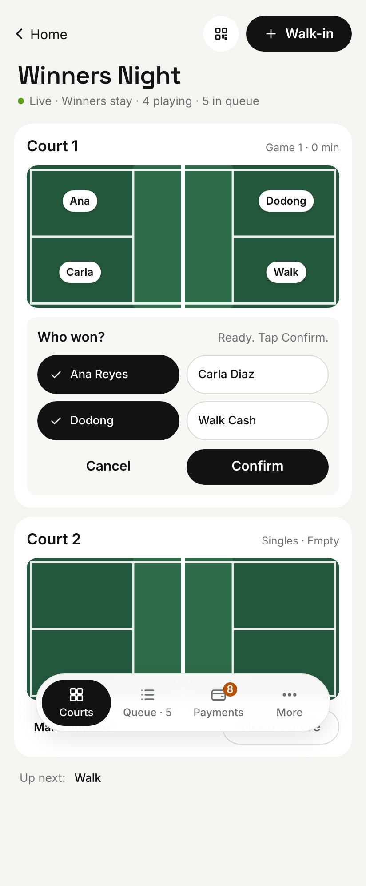 | 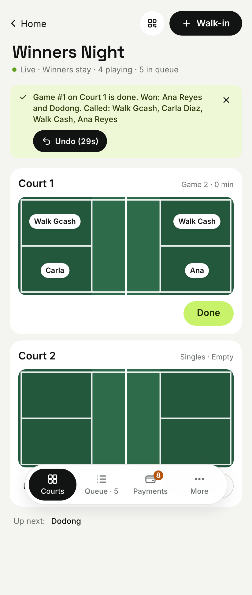 |

**Why it matters.** This happens at the end of every Winners-stay game. The wrong pair stays on, and the real winners go to the back. Players will argue, and the organizer can't see why the app "chose" it.

**Direction.**
- Lay the picker out like the court: left pair and right pair.
- Or have the organizer tap a **side** of the drawing (two taps become one).
- At minimum, warn when the picked two weren't drawn on the same side.

**Product decision?** Yes: whether the app should know teams (D11).

### UX-02 (U2, known): the player's line shows only 6 names

**Steps.** 12 in queue. A player opens View courts.

**User thinks.** "That's the whole line." Names look missing compared with the organizer's Queue.

**Actually.**
- "Get ready" shows 4 names and "After them" shows 2, then the list stops.
- There is no "and 6 more".

| Player (12 waiting) | Organizer Queue (same moment) *(full page)* |
|---|---|
| 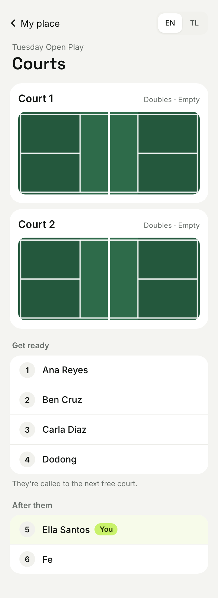 | 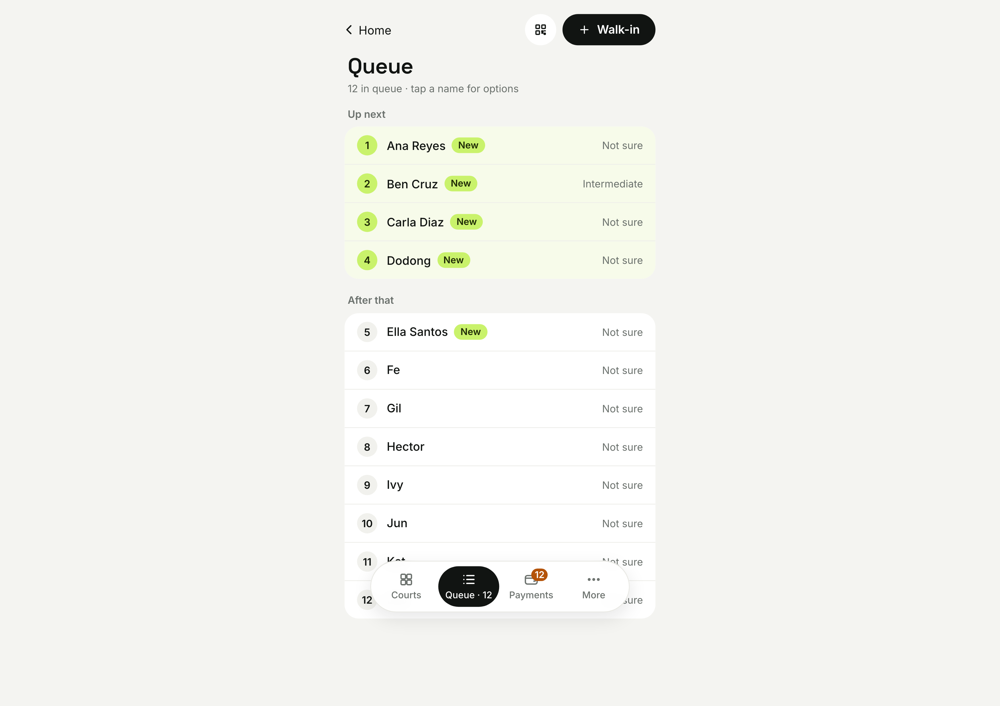 |

**Why it matters.** A player at #9 sees a list without their own name. They ask the organizer "did I get removed?".

**Direction.**
- Add "+ 6 more waiting" under the list.
- Always show the player's own row, even below the cut.

**Product decision?** No.

### UX-03 (U1): the same player has different numbers

**Steps (pay first on).**
1. Ben checks in and doesn't pay.
2. Four players with references are called.

What each screen shows at that moment:

| Who | Screen | Shows |
|---|---|---|
| Ben | My place | **1** · "You're first in line" · "You'll be skipped until you pay." |
| Ben | View courts | Himself in **On hold**, with no number |
| Organizer | Queue | Ben **On hold**, no number |

Later, Dodong (reference sent, callable):

| Who | Screen | Shows |
|---|---|---|
| Dodong | My place | **5** · "You're in the next group" · "Ahead of you: Ella Santos, Fe Lim, Walk Later" |
| Organizer | Queue | Dodong **#1 Up next**. The three "ahead" are all On hold (unpaid) |

The same pattern shows up for other states:

| Situation | One screen | Other screen |
|---|---|---|
| A resting player | Player: "Your spot is saved (#6)" | Organizer: On hold, no number |
| An On-hold player | Organizer's own sheet: "#1 in queue" | Organizer's list: no number |

*(known variant: "#11" in the banner vs #9 in the list.)*

| Ben: "1, first in line" | Ben's own Courts view: On hold | Organizer: On hold |
|---|---|---|
| 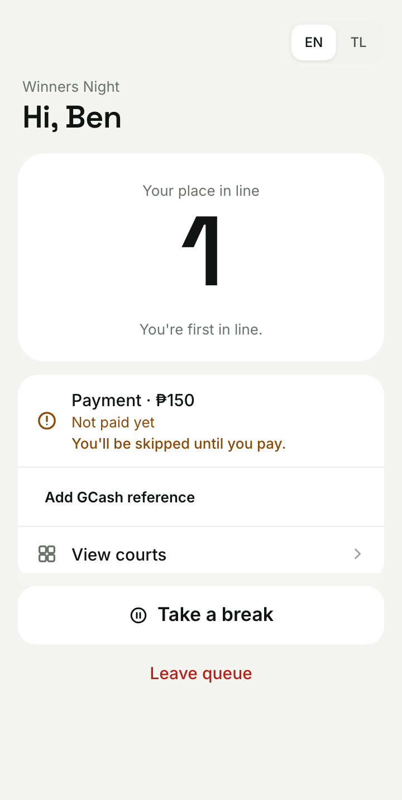 | 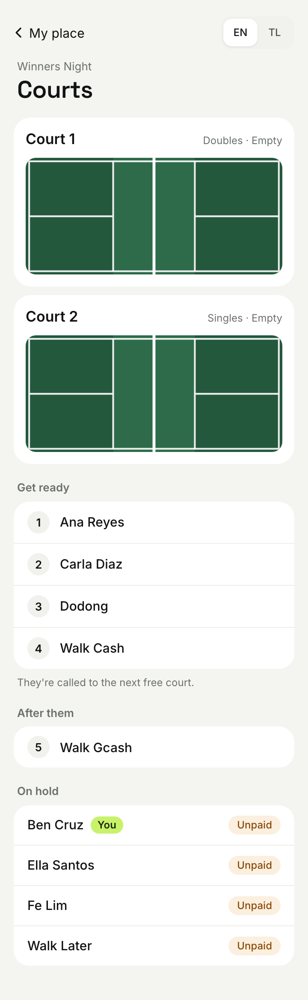 | 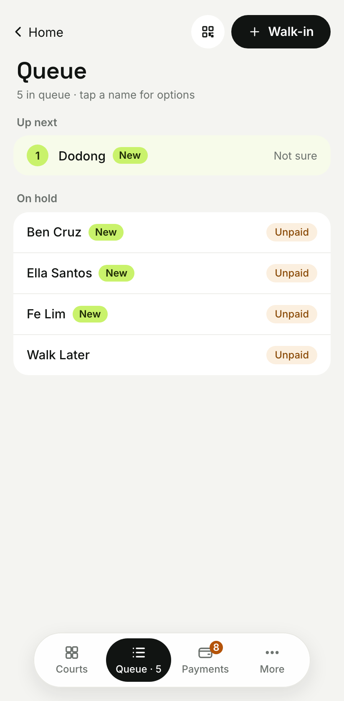 |

| Dodong: "5 · next group" | Organizer: Dodong #1 | Resting "#6" | Organizer sheet "#1 in queue" for On hold |
|---|---|---|---|
| 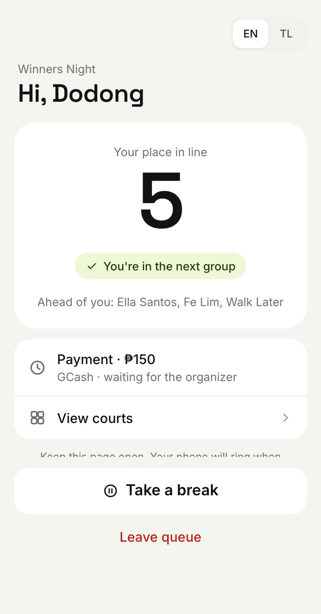 |  | 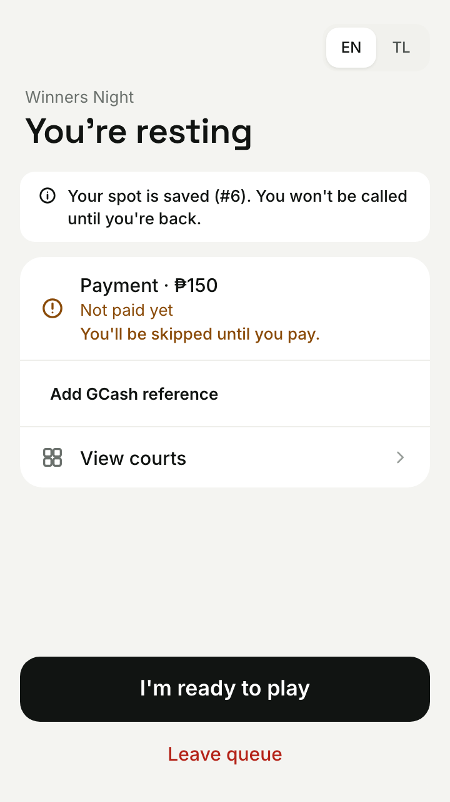 | 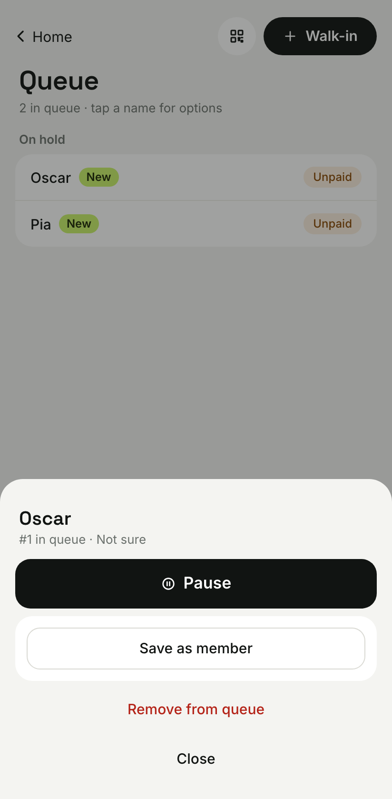 |

| Resting player: "Your spot is saved (#6)" | Organizer at the same moment: Gino in On hold, "Resting", no number *(full page)* |
|---|---|
|  | 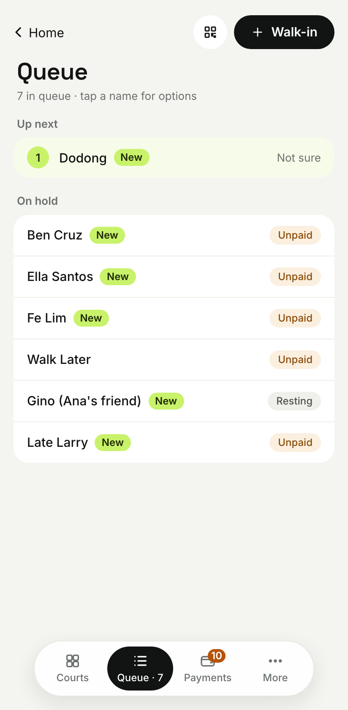 |

**User thinks.**
- Ben: "I'm next."
- Dodong: "4 people before me, I have time to buy water."

**Actually.**
- Ben will never be called until he pays.
- Dodong is called next.

**Why it matters.**
- People miss their call.
- Players argue "I was #1!".
- The organizer and player can't agree on a number to talk about.

**Direction.** One numbering everywhere: count only callable players, and show on-hold and resting people without a number and with the reason ("On hold · pay to get a number").

**Product decision?** Light: what number a resting player keeps.

### UX-04 (U3, known): "Not sure" reads like a status

**Steps.** Look at the Queue tab.

**User thinks.** "Not sure" at the right edge, where Unpaid and Resting chips go, reads as "not sure if coming".

**Actually.** It's the player's level.

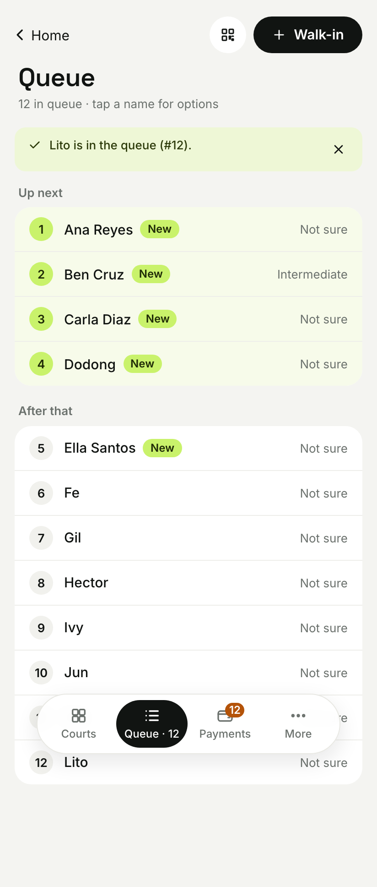

**Why it matters.** An organizer may skip or pause someone who is actually here.

**Direction.**
- Label it ("Level: not sure") or move it under the name.
- Or drop "not sure" from the list.

**Product decision?** No.

### UX-05 (U2, known): every player sees who is Unpaid

**Steps.** Pay first on. Any player opens View courts.

**Actually.** "On hold" lists every unpaid player with an "Unpaid" chip, in English and Taglish ("Bayad muna").

**Why it matters.**
- Public shaming at a social game.
- Players also learn who can be "skipped".

**Direction.** On players' phones, show other on-hold players without a reason (or only a count). Show the reason only on the player's own row.

**Product decision?** Yes.

### UX-06 (U1, known and wider): any reference makes a player callable

**Steps (pay first on).** Three players "pay" by entering a reference:

| Player | Entered | Result |
|---|---|---|
| Ana | her real reference | callable |
| Dodong | Ana's reference, copied from her screenshot in the group chat | callable |
| Quino | "123456" | callable |

**User thinks.** Organizer: "Pay before queueing" means nobody plays until I've checked the money.

**Actually.**
- All three become callable at once and are called.
- "Same ref as Dodong / Same ref as Ana Reyes" appears only on the Payments tab. Courts shows no hint, and by then Dodong is on court.

| Payments: same ref, to check | Dodong called anyway | "123456" → called |
|---|---|---|
| 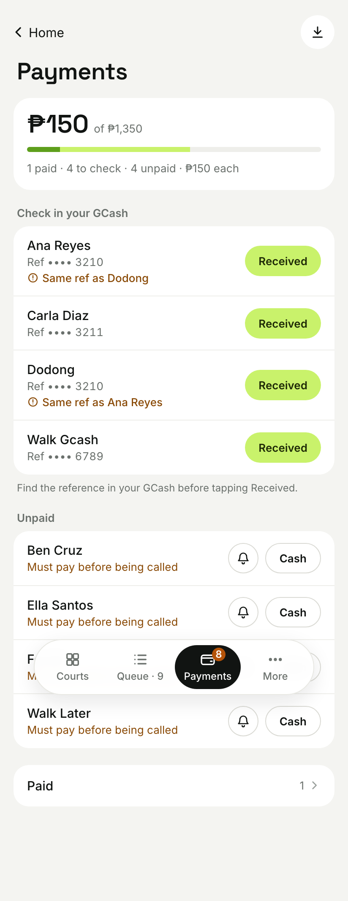 | 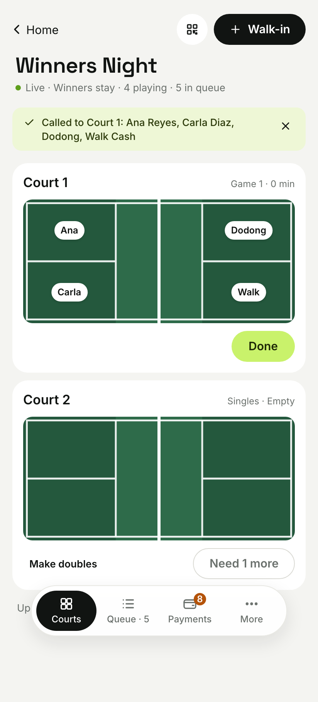 | 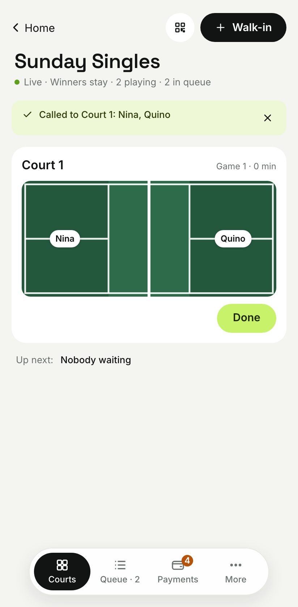 |

**Why it matters.**
- The organizer can only check GCash between games.
- Free play is one copied screenshot away.

**Direction.**
- D24 ("paid before joining the line").
- Until then, treat a duplicate reference as not callable, and flag "to check" players on Courts.

**Product decision?** Yes (D24).

### UX-07 (U1): ending the session drops the last games' players from Unpaid

**Steps.**
1. 12 players, 2 courts, All off, 2 games finished.
2. Court 1 is in game 3 with Ben, Jun, Kat and Lito.
3. Tap End session.

**User thinks.** The summary lists everyone who owes money.

**Actually.**

| Summary shows | Should be |
|---|---|
| **Players 12** | 12 |
| Payments "₱150 **of ₱1,200** · 1 paid · 0 to check · **7 unpaid**" | of ₱1,800, 11 unpaid |
| Ben, Jun, Kat and Lito: "0 games", missing from **Unpaid** | listed under Unpaid |
| **"Games 4"** (counts the unfinished games) | 2 finished games |

Before End, the Payments tab said "of ₱1,800 · 11 unpaid". The rule (`summarizePayments`) counts only players with a finished game, or who paid, after End.

| Court 1 in progress just before End | Summary *(full page)* |
|---|---|
| 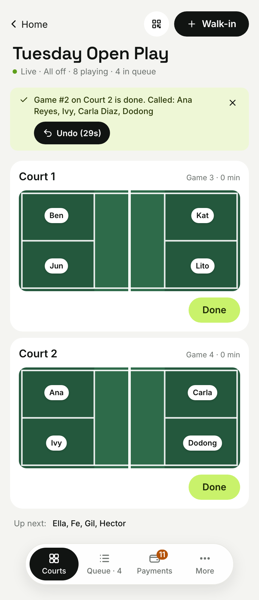 | 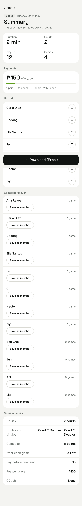 |

**Why it matters.**
- Every session ends with someone mid-game.
- Those players are never chased for the fee.
- The ₱ total doesn't match the cash box.

**Direction.**
- Count everyone who was on court or checked in and wasn't removed.
- Or ask at End: "Court 1 is still playing. Count this game?"
- Make "Games" match the per-player counts.

**Product decision?** Yes: who owes when they checked in but never finished a game.

### UX-08 (U1): Winners stay sends a winner off, with no reason

**Steps.**
1. Winners stay; 9 in line, but only 1 callable (4 unpaid on hold).
2. Ana and Dodong win.

**User thinks.** "Winners stay": Ana and Dodong stay on.

**Actually.**
- The banner says "Won: Ana Reyes and Dodong. Called: Walk Gcash, **Carla Diaz, Walk Cash**, Ana Reyes".
- Both losers are back on and the winner Dodong is "Up next". This is D23: fewer than 2 callable waiting, so everyone goes off, losers first.
- Nothing on screen says why. The Queue says 5 waiting.

**Why it matters.**
- Dodong just won and is told to sit.
- Carla lost and plays again.
- The organizer can't explain it.

**Direction.** Make the banner say it: "Only 1 player can be called, so everyone came off. Dodong sits out this one." Also say so in the "After a game" hint in More.

**Product decision?** No (D23 exists; it needs words).

### UX-09 (U2): "Nobody else is waiting" while the Queue shows people

**Steps.**
1. Pay first on, singles court.
2. Nina and Quino are playing; Oscar and Pia haven't paid.
3. Tap Done.

**User thinks.** "Nobody else is waiting" means nobody is here.

**Actually.**
- Header: "2 in queue". Tab: "Queue · 2". Payments badge: 4.
- Oscar and Pia are waiting but On hold.
- In scenario 2, Court 2 showed "Need 1 more" while the Queue tab said 5 (4 on hold). The tap message ("Need N more players to call this court.") doesn't mention them either.

| Courts: "Nobody else is waiting" | Queue at the same time |
|---|---|
| 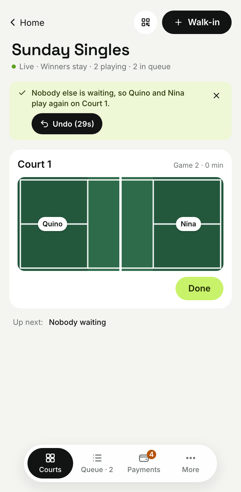 | 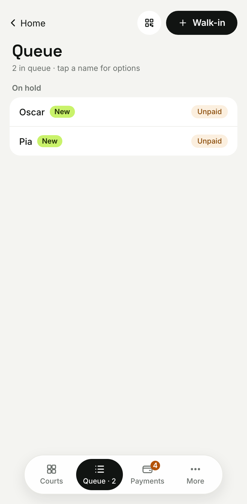 |

**Why it matters.** The organizer walks over to Oscar and Pia to ask why they're not playing. Or they assume the app is broken.

**Direction.** Say who is held and why: "Nobody else can be called. 2 are waiting to pay." Also on "Need N more".

**Product decision?** No.

### UX-10 (U1): "Not ready" in the middle of a game jumps to the front

**Steps.**
1. Mark is called and taps On my way. He is now on the "Playing on Court 1" screen.
2. Mid-game, he taps **Not ready yet** → "Yes, I'm not ready".
3. The organizer sees "Mark isn't ready · Swap" and taps it.

**Actually.**
- W5 is put into the game already in progress.
- Mark is "first in the queue" and is called again at the next Done.
- His partial game counts as 0 games.

| Mid-game: Not ready offered | Organizer: Swap | Mark: #1 again |
|---|---|---|
| 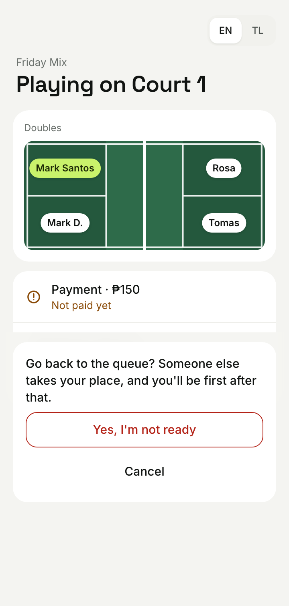 | 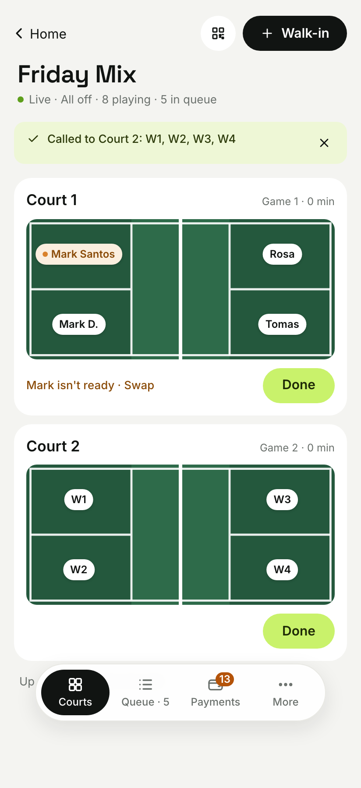 | 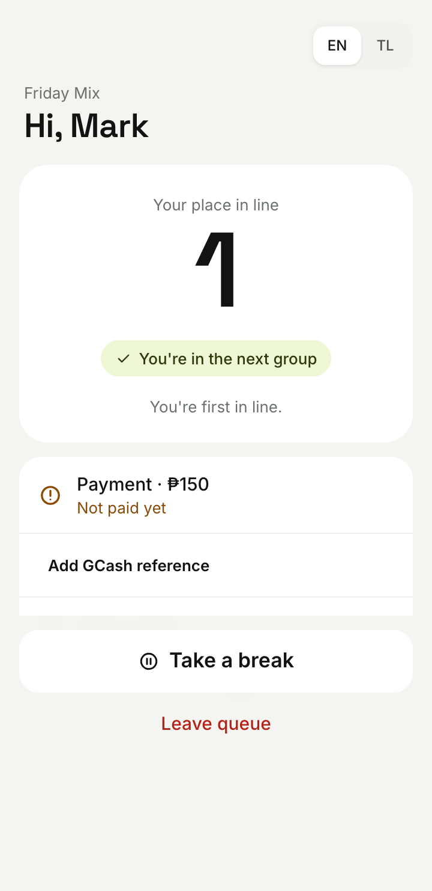 |

**Why it matters.** A player losing badly (or wanting other partners) can walk off and be first for the next game. Also listed under loopholes.

**Direction.**
- Hide "Not ready yet" after "On my way" or after the first minute.
- A real swap mid-game should send the player to the back, not the front.

**Product decision?** Yes (BR19 scope).

### UX-11 (U1): "On my way" doesn't take back "Not ready"

**Steps.**
1. Rosa taps Not ready yet → Yes.
2. A moment later her friend arrives, so she taps **On my way**.

**User thinks.** "I'm going after all."

**Actually.**
- Her phone shows "Playing on Court 1" **and** "The organizer knows. Wait to be swapped".
- The organizer still sees "Rosa isn't ready · Swap".
- With two flagged players, the organizer tapped the first "isn't ready · Swap" on Courts. The banner was "**Uma replaced Rosa** on Court 1", although Rosa was on court.
- There's no way for a player to cancel "Not ready".

| Rosa on court, still flagged | Organizer swaps Rosa out |
|---|---|
| 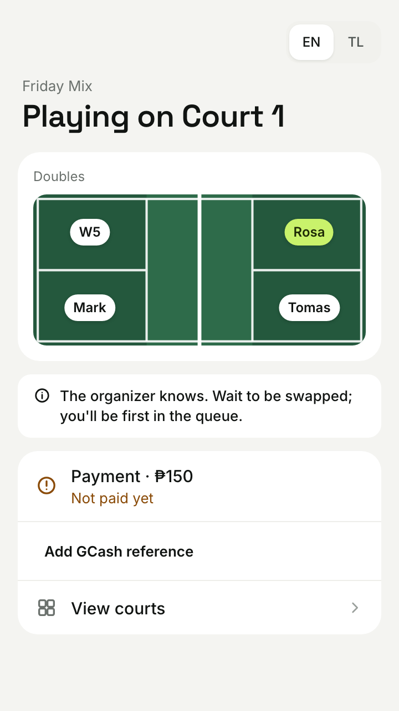 | 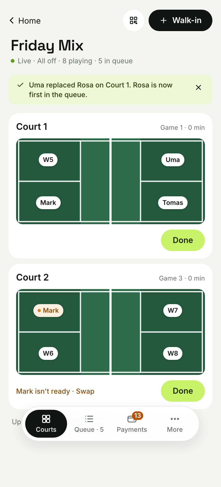 |

**Why it matters.** A ready player is taken off the court.

**Direction.** "On my way" (or an "I'm ready after all") clears the flag and the organizer's Swap.

**Product decision?** No.

### UX-12 (U3): after "Not ready" the screen still says "Your turn… Head to Court 1"

**Steps.** Called → Not ready yet → Yes.

**User thinks.**
- "Did it work? It still says Your turn."
- The big green "On my way" invites a tap.

**Actually.** The flag is set. Only the small note "The organizer knows. Wait to be swapped; you'll be first in the queue." says so.

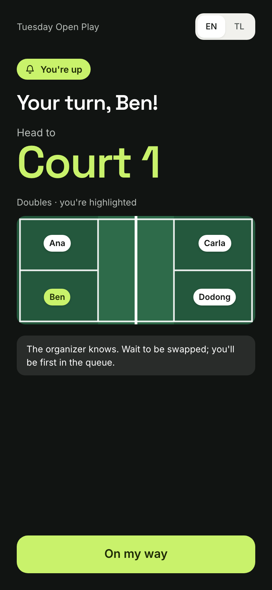

**Direction.** Change the heading to "Waiting to be swapped" and drop "Head to Court 1". Make "On my way" a secondary action.

**Product decision?** No.

### UX-13 (U2): Undo after a call: the player isn't told

**Steps.**
1. Done on Court 2 calls Mark. His phone shows "Your turn, Mark! Head to Court 2", with a chime and, if on, Tagatawag reading it aloud.
2. The organizer taps Undo.

**Actually.** Mark's phone silently goes back to "Your place in line 1". No "call cancelled" message.

| Called | After Undo |
|---|---|
| 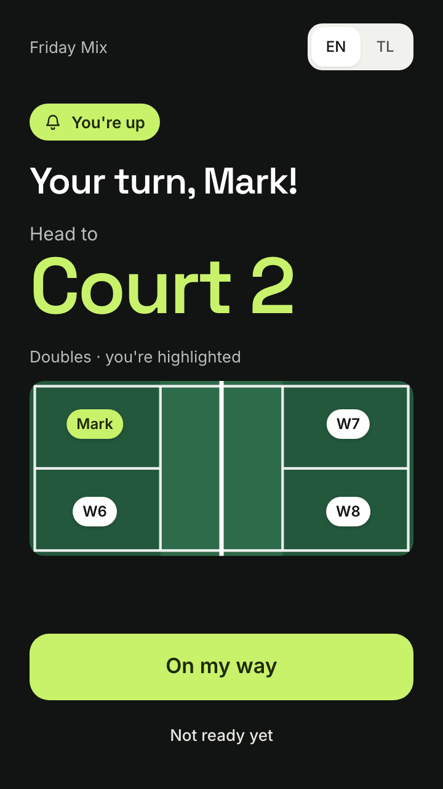 |  |

**Why it matters.**
- Mark is already walking to Court 2.
- If he looked away, he doesn't know.

**Direction.** Show "Sorry, that call was cancelled. You're still #1." on the phone (and read it aloud).

**Product decision?** No.

### UX-14 (U1): removed by the organizer: the phone doesn't say so

**Steps.**
1. Rico is #1.
2. The organizer removes him: Queue › Rico › Remove from queue › Yes.

**Actually.**
- 4 seconds later, Rico's phone still shows "1 · You're in the next group · You're first in line".
- After a reload it shows the check-in page: "Last time you joined as Rico · **Join as Rico**". There's no word that he was removed.
- One tap puts him back at the end.

| 4 s after removal | After reload |
|---|---|
| 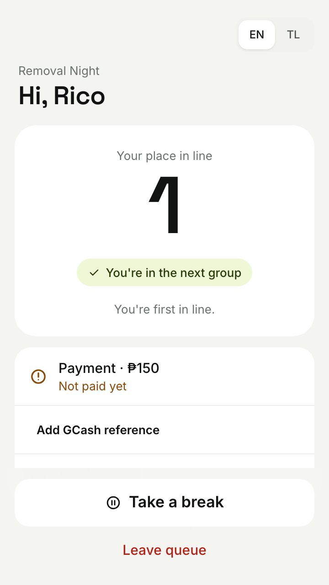 | 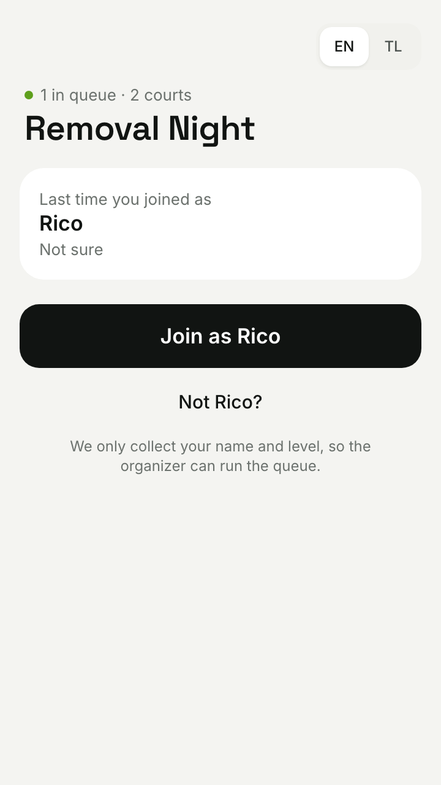 |

**Why it matters.**
- Rico waits for a call that never comes.
- Or he rejoins, which undoes the organizer's decision (e.g. removed for not paying).

**Direction.**
- Push the removal and show "The organizer removed you from the queue. Ask them if this is a mistake."
- Consider blocking a one-tap rejoin of a removed name.

**Product decision?** Yes (may a removed player rejoin on their own?).

### UX-15 (U2): organizer's "Pause" shows the player "You're resting"; four words for one state

**Steps.** Queue › Oscar › **Pause**.

What each screen says:

| Screen | Says |
|---|---|
| Banner | "Oscar is **paused** and won't be called until resumed." |
| Chip | "**Resting**" |
| Oscar's phone | "**You're resting** · Your spot is saved (#1)" |
| Player's own button | "**Take a break**" |

| Organizer after Pause | Oscar's phone |
|---|---|
| 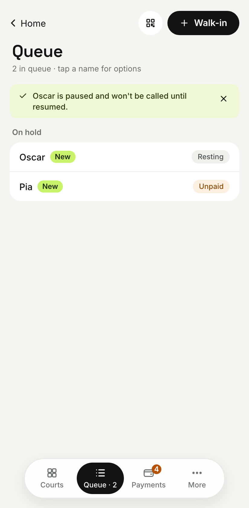 | 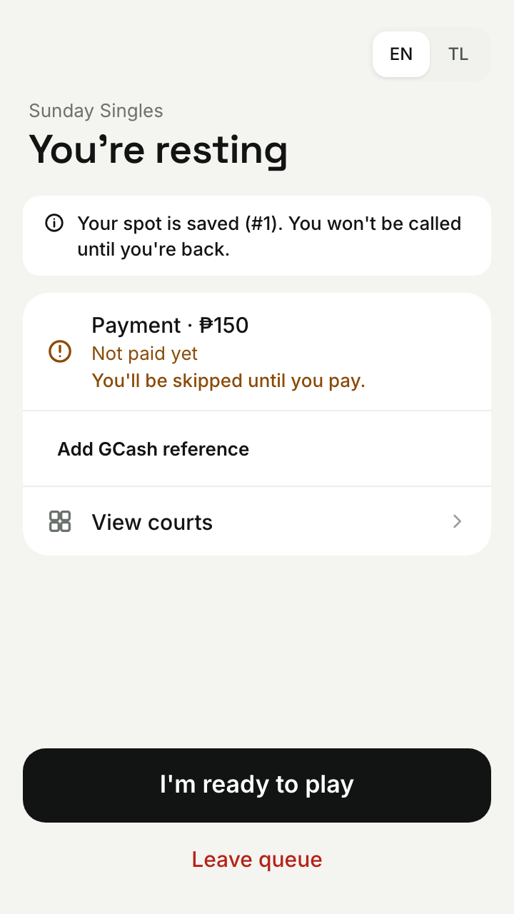 |

**User thinks.**
- Oscar: "I didn't take a break, why am I resting?"
- His screen offers "I'm ready to play", which ends the organizer's pause from the player's side.

**Direction.**
- One word everywhere (CLAUDE.md lists "Resting").
- When the organizer paused them, say "The organizer paused you".

**Product decision?** Small: may a player resume an organizer's pause?

### UX-16 (U2): "Your phone will ring when you're called" over-promises

**Steps.** Join, read My place.

**User thinks.** "I can pocket my phone; it will ring like a call."

**Actually.** `src/lib/player/alert.ts` plays a short chime through the browser only when all of these hold:
- the page is open, in the foreground, with the screen on;
- audio was unlocked by a tap.

On top of that:
- iPhone has no vibration.
- The silent switch mutes it.
- The screen-lock prevention works only where the browser supports it.

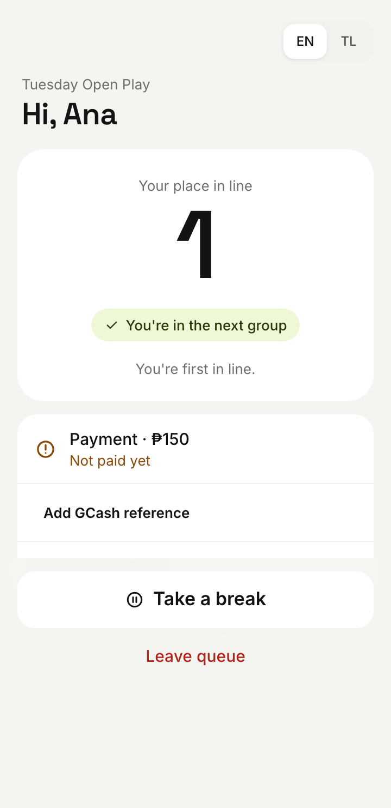

**Why it matters.** The most common miss: a player locks the phone, misses the call, and the court waits. Players then blame the organizer.

**Direction.**
- Say what really happens: "Keep this page open and the screen on. You'll hear a short tone."
- Rely on Tagatawag and the organizer calling names.

**Product decision?** No.

### UX-17 (U2): the reference form is under the pinned footer on small phones

**Steps.** 360×640, Add GCash reference, scroll to the field.

**Actually.**
- The pinned "Take a break / Leave queue" panel (about a quarter of the screen) covers the reference field and **Send reference**.
- At the centre of the Send button, `elementFromPoint` returns the footer's `DIV`, not the button.
- With the keyboard open there is even less room.

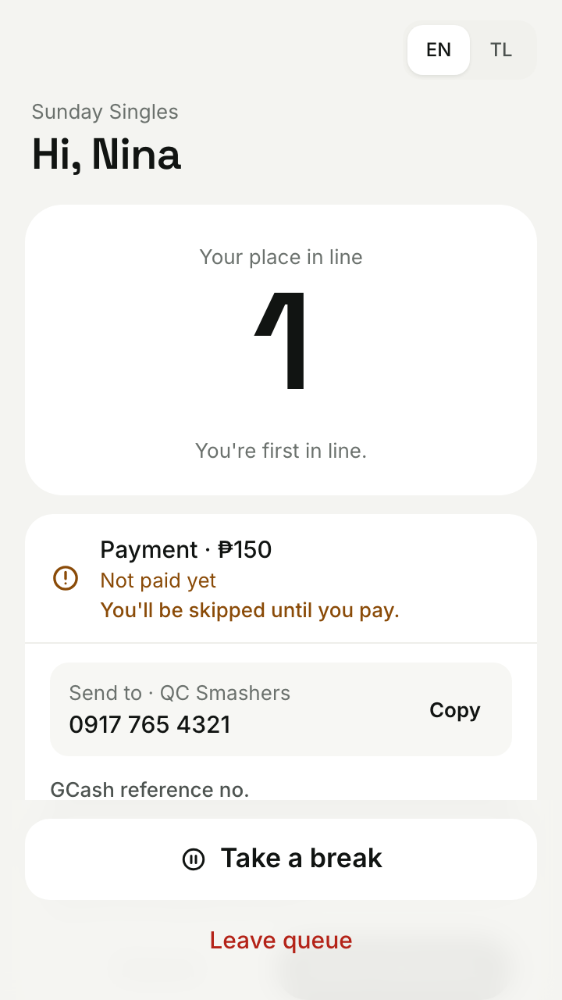

**Why it matters.** "Take a break" sits exactly where "Send reference" should be, so a mis-tap pauses the player.

**Direction.** Hide the pinned footer while the reference form is open, or put the form in a sheet.

**Product decision?** No.

### UX-18 (U2): a club with no GCash still asks for a GCash reference

**Steps.** Club with no GCash number in Settings. Player taps Add GCash reference.

**Actually.**
- The form asks for "GCash reference no." with no "Send to" box.
- The ready message "The club has no GCash number. Pay cash, or ask the organizer." (in the dictionary) isn't shown.
- With pay first on, the phone offers no other way to pay.

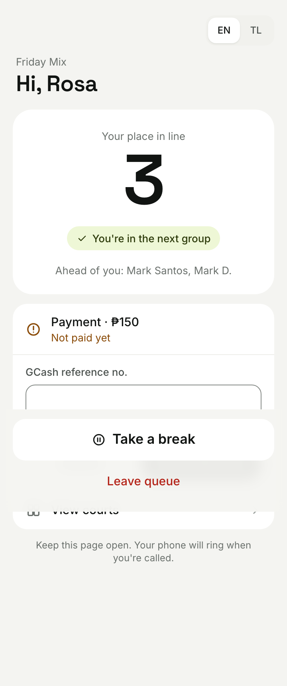 *(full page)*

**Direction.** Hide "Add GCash reference" when the club has no number, and show the "pay cash to the organizer" line.

**Product decision?** No.

### UX-19 (U1): pay first + walk-in "Pay later" is never called

**Steps.** Pay first on. + Walk-in › Pay later › Add to queue.

**User thinks.** "Pay later" means play now, pay later.

**Actually.**
- The walk-in goes straight to **On hold · Unpaid** and is never called.
- The form's three choices (Paid cash / GCash / Pay later) say nothing about pay first.

| Walk-in form (pay first on) | Walk Later on hold |
|---|---|
| 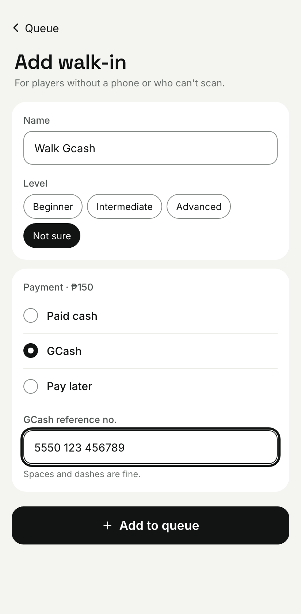 | 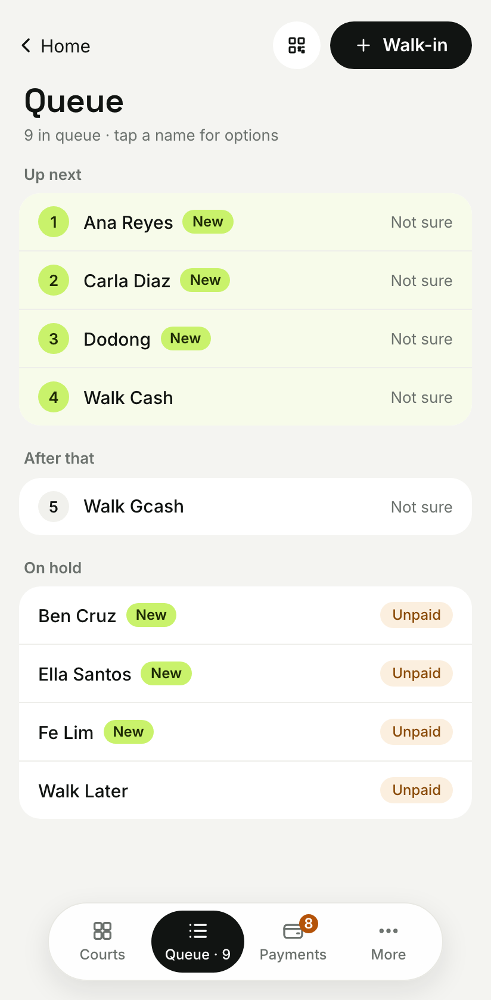 |

**Why it matters.** An older walk-in without a phone sits for an hour, and nobody notices until they complain.

**Direction.**
- Under pay first, label it "Pay later (won't be called until paid)".
- Or hide it and offer only "Paid cash / GCash".

**Product decision?** Yes (is "pay later" allowed under pay first?).

### UX-20 (U3): laptop: "Up next" is under the tab bar

**Steps.** Courts on a 1280×800 laptop, at load.

**Actually.**
- The page is a phone-width column.
- "Up next:" (the line saying who is called next) sits under the floating tab bar until you scroll.

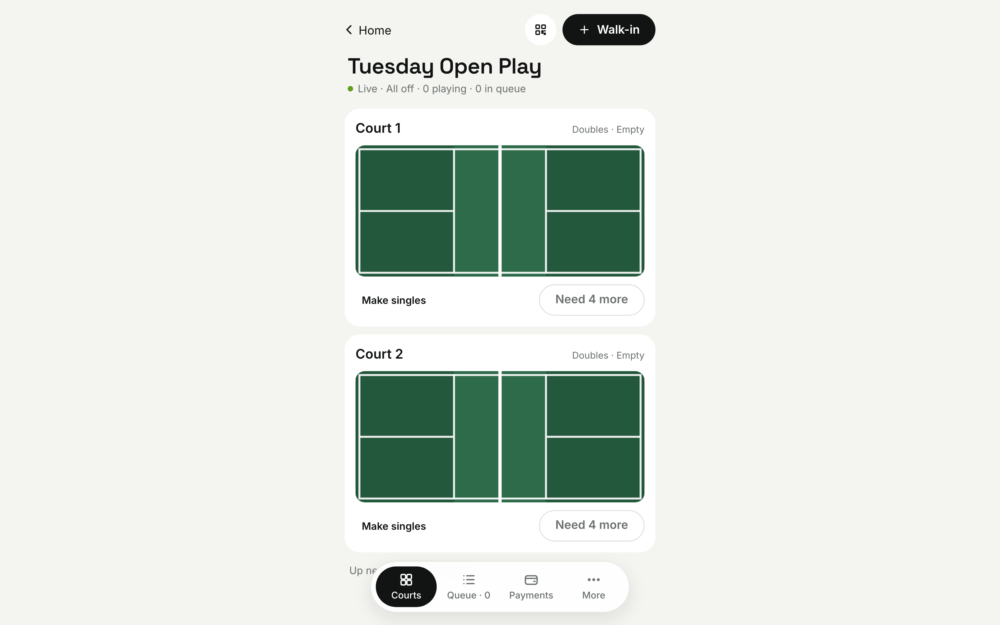

**Direction.** Add bottom padding equal to the tab bar, or move "Up next" above the courts.

**Product decision?** No.

### UX-21 (U3): game numbers count the whole session

**Steps.** Call Court 1, then Court 2.

**Actually.**
- Court 2's first game is "**Game 2**".
- The next game on Court 1 is "Game 3".
- Banners read "Game #2 on Court 2 is done".
- On players' View courts, a playing court reads "Doubles · **#2**", the same "#" used for places in line.

| Organizer | Player (Taglish) |
|---|---|
| 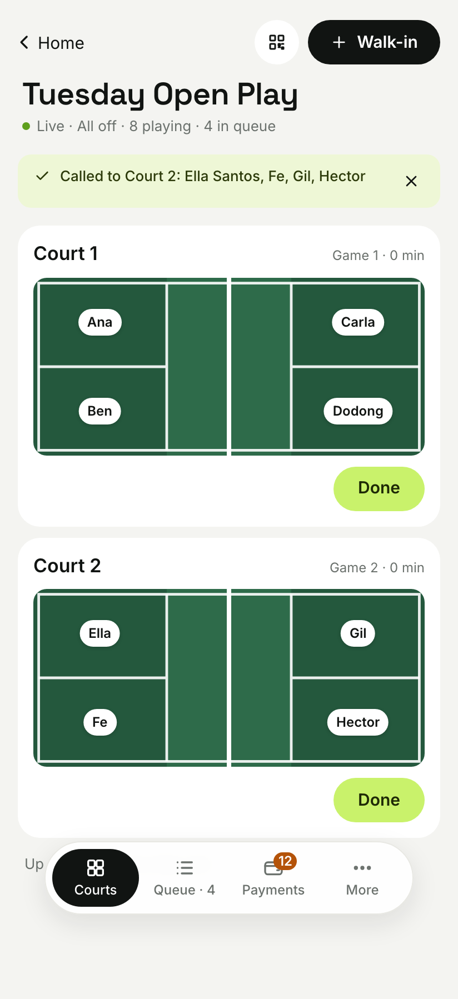 | 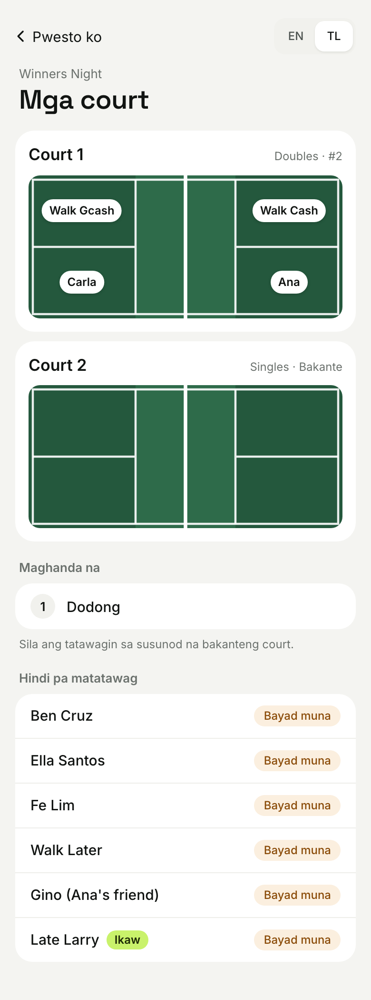 |

**Direction.** "Court 2 · game 1", or drop the number on the player side.

**Product decision?** No.

### UX-22 (U3): "Ahead of you" shows only 3 names

**Steps.** A player at #5.

**Actually.**
- "Ahead of you: Ben Cruz, Carla Diaz, Dodong". Ana (#1) is missing, so it reads as a complete list of 3.
- Under pay first it includes players on hold (see UX-03).

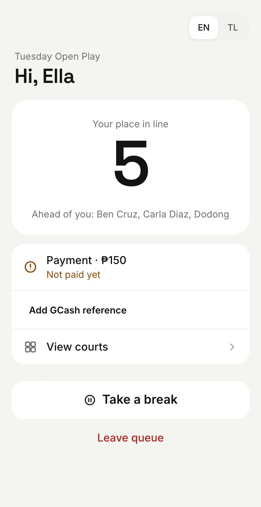

**Direction.** "Just ahead of you: …" or "4 ahead of you: …".

**Product decision?** No.

### UX-23 (U3): the Payments badge number

**Steps.** Look at the tab bar.

**Actually.**
- "Payments" carries a red bubble (12, 8, 4…) that counts unpaid **plus** "to check".
- "Queue · 5" uses a plain count instead.
- The red bubble looks like alerts or errors, and nothing says what it counts.

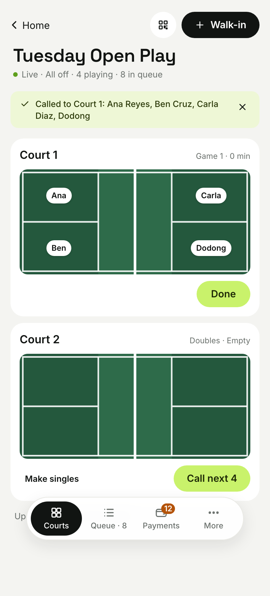

**Direction.** Label it the same way as Queue ("Payments · 8 to do"), or count only what needs action now.

**Product decision?** No.

### UX-24 (U3): Payments rows move while "Cash" is one tap

**Steps.** Keep Payments open during games.

**Actually.** Unpaid rows follow queue order, so they reorder as players are called and re-queued:

| Moment | Order |
|---|---|
| Start | Ana, Ben, Carla… |
| Later | Ana, Carla, Dodong… Ben moved down |

"Cash" marks paid in one tap. There is a 30 s Undo.

| Start | Mid-session |
|---|---|
| 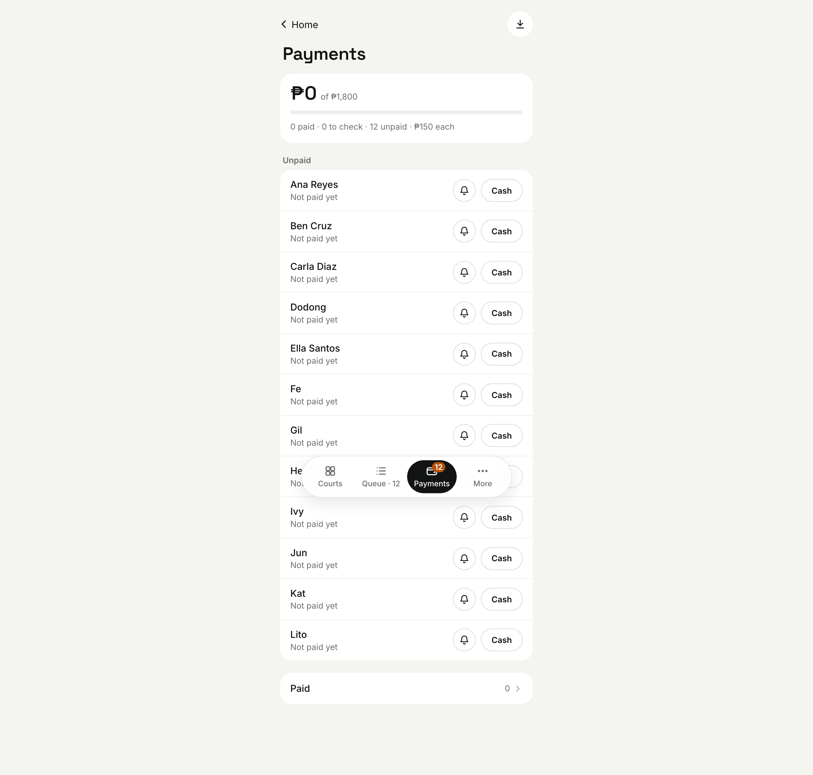 | 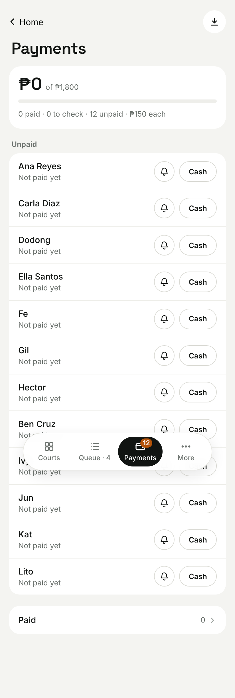 |

**Why it matters.** With Realtime updates, a row can move between look and tap, so the wrong person is marked paid.

**Direction.** Sort Payments alphabetically (or by check-in), not by queue.

**Product decision?** No.

### UX-25 (U4): "New" stays on players who already played

Dodong shows **New** in Up next right after his first game. "New" means "checked in during the last 10 minutes", but reads like a first-timer.

**Direction.** Drop "New" once the player has been called.

### UX-26 (U3): two QRs

**What the organizer sees.**
- **Show QR** shows the session QR (a `/j/…` code that changes every session) and says "The club has a permanent QR".
- Settings › Club QR code is a different one (a `/c/…` code that stays the same). (The two screenshots are from two test clubs.)

**What's unclear.**
- Which one to print?
- Do players need to scan again next week?

| Session QR | Club QR |
|---|---|
| 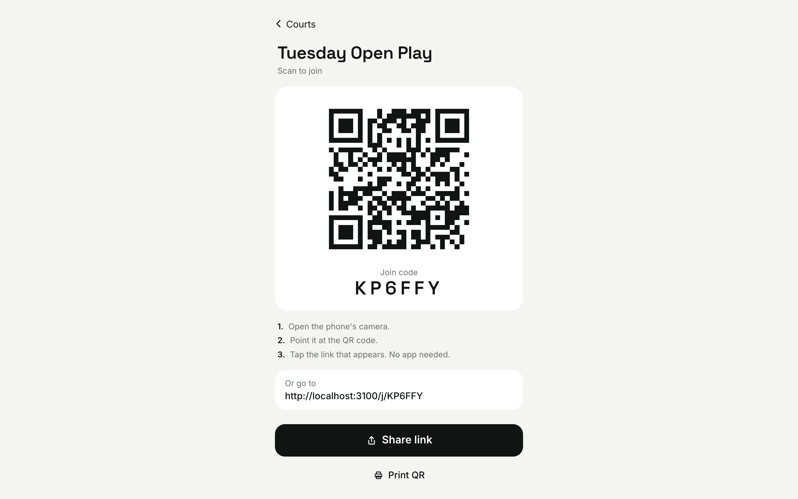 | 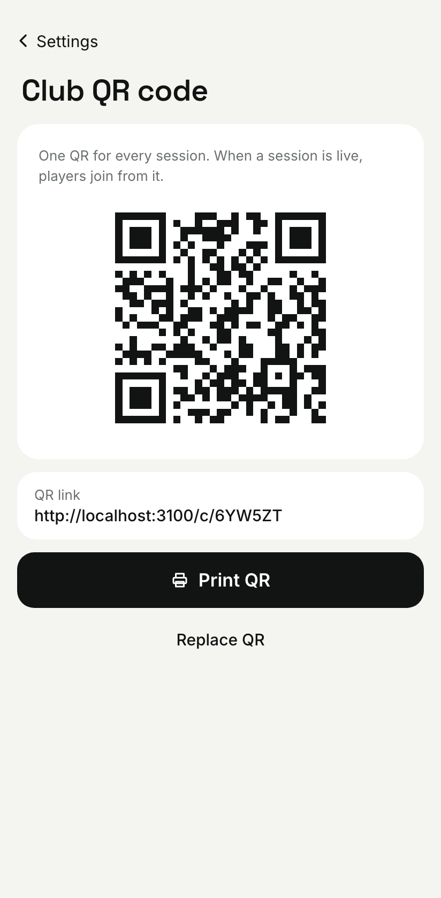 |

**Direction.** One recommended QR (the club one), with the session one as "for this session only".

**Product decision?** Light.

### UX-27 (U4): Taglish: the same thing in different words, English left over

| Meaning | Organizer (TL) | Player (TL) |
|---|---|---|
| On hold section | Naka-hold | Hindi pa matatawag |
| Unpaid chip | Bayad muna | Bayad muna |

- "**Bayad muna**" (literally "pay first") reads as an instruction to the reader, not a state.
- English remains in the Taglish UI: "Courts", "Home", "Walk-in", "Live", "Doubles/Singles", "Court 1".
- "Not paid yet" (row) and "Unpaid" (section/chip) are used for the same state in English, against the one-word rule in CLAUDE.md.
- The guide says "Download (Excel)"; the file is a CSV.

| Organizer Queue (TL) | Player Courts (TL) |
|---|---|
| 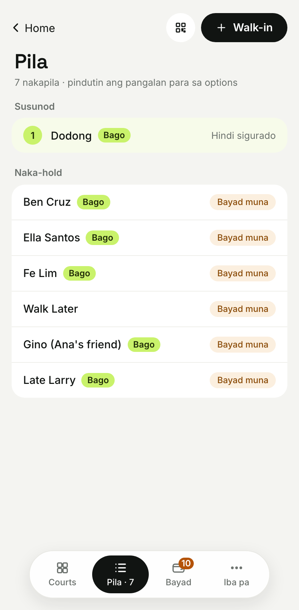 |  |

**Direction.** One term per state in each language; e.g. "Hindi pa bayad" for the chip.

**Product decision?** No.

## 4. Fairness loopholes (player side)

| # | Loophole | Steps | Seen in |
|---|---|---|---|
| L1 | **Not ready mid-game → front of the line** | Called → On my way → play → "Not ready yet" → organizer taps Swap → first in line, partial game not counted | UX-10 |
| L2 | **Pick your game with repeated Not ready** | Each time you're called with partners you don't like, "Not ready yet" → swapped → **first again**. Repeat until a group you like comes up. Nothing limits it. | Scenario 3: Mark was swapped to first, re-called, and could flag "Not ready" again right away; the same Swap rule applies each time |
| L3 | **Check in from home, hold the place with a break** | The session QR or link is shareable, and the club QR works from anywhere while a session is live. Check in from home → Take a break ("Your spot is saved (#6)") → arrive an hour later → "I'm ready to play" → you're ahead of everyone who arrived meanwhile. | Gino (#6) stayed ahead of Late Larry (#7) |
| L4 | **Hold places for absent friends** | Open the link in another browser or incognito → check in "Gino (Ana's friend)" → Take a break. The duplicate-name check only blocks the same name. | Scenario 2 |
| L5 | **Copied or fake reference = callable** (pay first) | Copy a friend's reference, or type 123456 → called immediately. The warning is only on Payments. | UX-06 |
| L6 | **Undo a pause, rejoin after removal** | After an organizer's Pause, the player's screen offers "I'm ready to play". After an organizer's Remove, it offers "Join as Rico" (at the end of the line). | UX-14, UX-15 |
| L7 | **"Pay later" walk-ins and on-hold players inflate the line** | Not a gain for the player, but the numbers in UX-03 let a player at "#5" believe four are ahead when none are callable. Players who see that leave and come back late. | UX-03 |

## 5. What was clear and worked well (keep these)

- **"Your turn, Ana! Head to Court 1"**: big court name, the player's chip highlighted, the drawing of who's on court. Instantly clear at arm's length.
  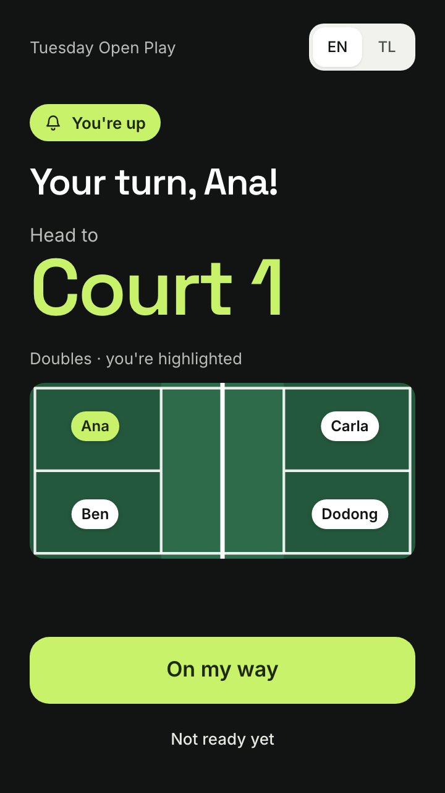
- **Banners that name people**:
  - "Called to Court 1: Ana Reyes, Ben Cruz, Carla Diaz, Dodong";
  - "Ivy replaced Ben Cruz on Court 1. Ben Cruz is now first in the queue.";
  - "Got Ana Reyes's cash."
  
  All of these come with a visible **Undo (29s)**.
  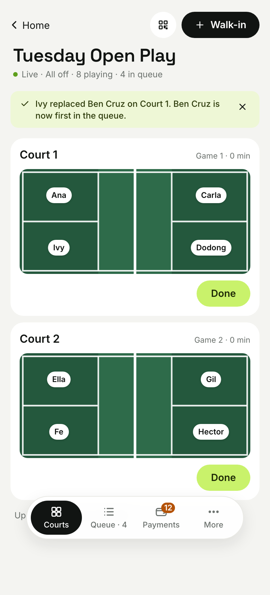
- **"Nobody else is waiting, so Quino and Nina play again"** explains a surprising result. It's the model for UX-08 and UX-09.
- **Confirm steps that say the consequence**:
  - "Leave the queue? If you come back, you'll join at the end."
  - "Go back to the queue? Someone else takes your place…"
  - "End the session? Check-in closes."
  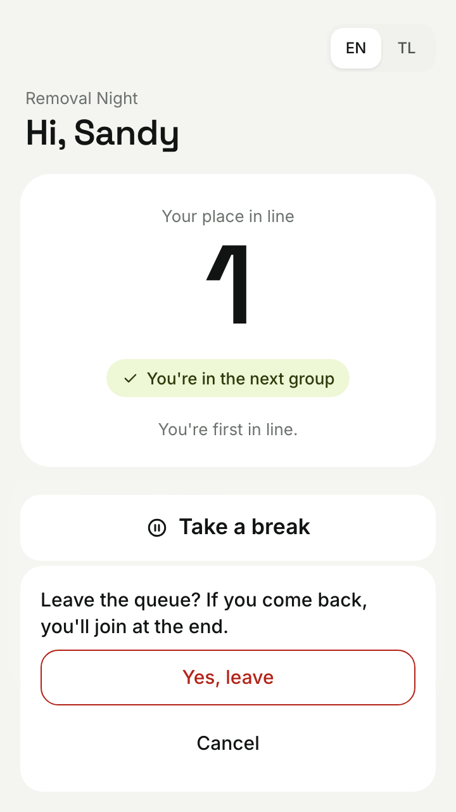
- **"Same ref as Dodong"** on Payments, and "Find the reference in your GCash before tapping Received."
- **Pay-first wording on Payments**: "Must pay before being called".
- **Short check-in**: name, optional level, one button. Returning players get "Join as Rico".
- **"After a game · Takes effect at the next Done."** in More, and "Everyone on court goes to the back of the queue" for mixed courts.
- **Offline**: "Needs signal to open Queue. Your taps are saved…" (QA-01).
- **Taglish coverage** is nearly complete, and the EN | TL switch is always in the same corner on player screens.
